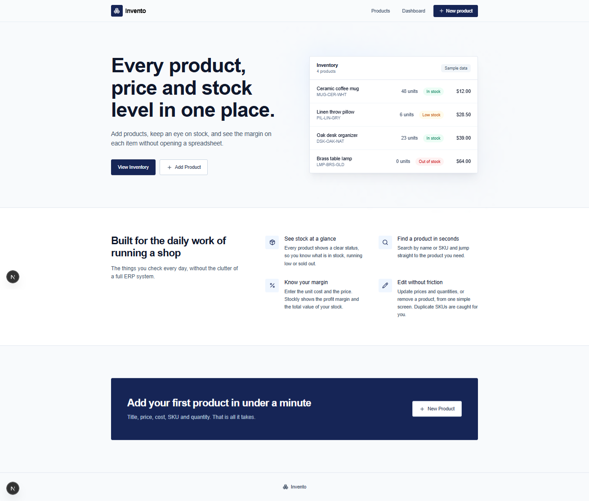
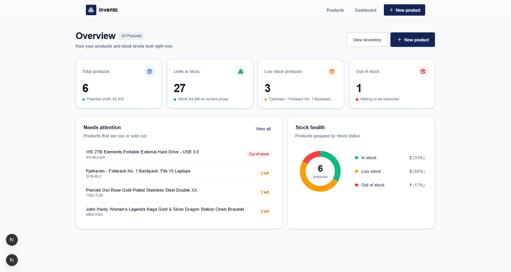
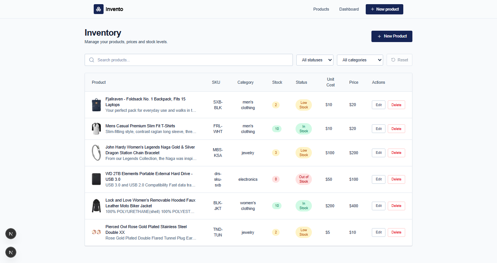

# Invento — Inventory Management Dashboard

Invento is a responsive inventory management dashboard built with **Next.js 16**. It helps users manage product records, monitor stock levels, and understand inventory value and potential profit from one place.

> This project was built as a portfolio project to practise the Next.js App Router, data fetching, caching, Server Components, Client Components, and CRUD workflows.

## Features

- **Inventory overview** — view products, prices, quantities, and stock status.
- **Product management** — create, view, edit, and delete products.
- **Stock monitoring** — identify in-stock, low-stock, and out-of-stock products.
- **Dashboard analytics** — review total products, units in stock, stock value, potential profit, and products needing attention.
- **Search** — find products by title or SKU.
- **Filtering** — filter by category and stock status; filters can be combined.
- **Form validation** — validate product information and check SKU uniqueness.
- **Loading and error UI** — provide feedback during navigation and data operations.
- **Responsive interface** — layouts designed for different screen sizes.
- **URL-based filters** — keep search and filter state in the URL.

## Tech stack

- [Next.js 16](https://nextjs.org/) — App Router, Server Components, Server Actions, Cache Components
- [React 19](https://react.dev/)
- JavaScript
- [Tailwind CSS 4](https://tailwindcss.com/)
- [Lucide React](https://lucide.dev/) — icons
- [React Toastify](https://fkhadra.github.io/react-toastify/) — toast notifications
- [MockAPI](https://mockapi.io/) — REST API for product data

## Screenshots

The images in this folder are **illustrative portfolio previews** created from the project's layout and feature set. They are not direct captures of a running browser session. Replace them with genuine screenshots of your deployed or locally running app before presenting them as application screenshots.

Inventory preview | Dashboard preview | Products preview 
  |  |  

## Getting started

### 1. Clone the repository

```bash
git clone <your-repository-url>
cd <your-project-folder>
```

### 2. Install dependencies

```bash
npm install
```

### 3. Configure the API

The project currently uses a MockAPI endpoint defined in:

- `lib/constants.js`
- `lib/actions.js`

Create your own MockAPI `products` resource and update the endpoint in both files if you want to use a separate dataset.

The product records used by the application include:

| Field | Type | Description |
|---|---|---|
| `id` | String | Generated by MockAPI |
| `title` | String | Product name |
| `description` | String | Product description |
| `image` | String | Product image URL |
| `category` | String | Product category |
| `sku` | String | Unique stock keeping unit |
| `cost` | Number | Unit cost |
| `price` | Number | Selling price |
| `quantity` | Number | Available stock quantity |

### 4. Run the development server

```bash
npm run dev
```

Open [http://localhost:3000](http://localhost:3000) in your browser.

## Available scripts

| Command | Description |
|---|---|
| `npm run dev` | Start the development server with Turbopack |
| `npm run build` | Create a production build |
| `npm run start` | Start the production server |
| `npm run lint` | Run ESLint |

## Project structure

```text
app/
  dashboard/          # Inventory analytics dashboard
  products/
    (list)/           # Product listing and filters
    [id]/             # Product details and edit route
    new/              # Create product page
  error.jsx
  loading.jsx
  not-found.jsx
components/            # Shared UI and interactive components
lib/
  actions.js           # Server Actions for product mutations
  constants.js         # API access and stock status
  inventory-stats.js   # Dashboard calculations
  product-query.js     # Search and filtering logic
public/                # Static assets
```

## Notes

- MockAPI is used as the project's data source; this is a learning/portfolio implementation rather than a production inventory backend.
- The API endpoint is currently configured directly in the source files. If you fork the project, replace it with your own endpoint.
- Currency formatting is currently configured for USD.
- Sorting controls are not included; the inventory view focuses on search, category filtering, and stock-status filtering.

## Author

**Ahmed Zaalani**

- GitHub: (https://github.com/ahmed7zaalani)
- LinkedIn: (https://www.linkedin.com/in/ahmed-zaalani/)
